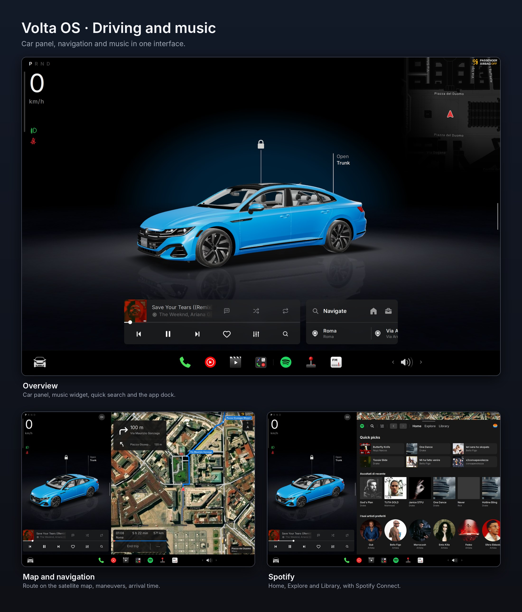
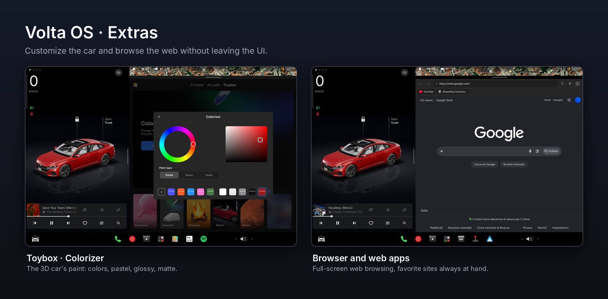

🚗 Volta OS
===========


**Volta OS** is the infotainment system I wished I could find in my own car: a full-screen in-car
interface for Linux, written from scratch in **Qt 6 / QML**, designed for a touchscreen and for everyday
use behind the wheel. Map, music, phone, CarPlay, video and games live together in one coherent
interface, with a 3D car you can customize however you like.

It is not a theme and not a skin: Volta OS is also a **Wayland compositor**. Native apps and games
(Wine/Bottles, gamescope) do not open next to the UI, but *inside* the UI.

It is an amateur project, born out of passion and carried forward with method: organized code,
documentation entry by entry, translations in five languages and a ready-to-download AppImage.

> Independent project, not affiliated with Tesla, Inc.

* * *

## ⚠️ Beta disclaimer

Volta OS is ambitious, but it is **not complete yet**: it is in **beta**. You may run into **bugs**
and **missing features**, which will be fixed and added in future releases.

**Your feedback matters a lot.** If something does not work, or if there is a feature you would like to see,
please let me know by opening an [issue](https://github.com/omardigiovanni3-beep/VoltaOS/issues): tell me what you
were doing, what you expected and what happened instead. Bug reports and feature requests are the best way to
help the project grow.

* * *

## 📋 Description

**Navigation.** A light, dark or satellite map with routes that take traffic into account, lane
guidance, speed camera alerts, weather along the way and gas stations.

**Audio.** One place for local music and USB sticks, YT Music (with synced lyrics),
Spotify with Spotify Connect, podcasts and international radio.

**Phone.** Over Bluetooth: music, calls, contacts and SMS. With a Carlinkit dongle, also CarPlay and
Android Auto.

**Entertainment while parked.** Theater (YouTube, Netflix and more), browser, sites used as apps and an Arcade for
Windows games, run with Bottles and gamescope directly in the UI.

**Customization.** Light, dark or time-based automatic theme; **left or right-hand drive** (with
right-hand drive the whole interface is mirrored); 3D car, dock, drawer and music widget configurable from
the settings. The interface is translated into Italian, English, Spanish, French and Portuguese.

* * *

## 📸 Preview

<p align="center">
  
</p>
<p align="center">
  
</p>

* * *

## 📚 Documentation index

**Start here**
- [Installation and dependencies](docs/installation.md): AppImage or building from source
- [API keys](docs/api-keys.md): which ones you need, what they unlock, where to get them (free)
- [Supported hardware](docs/hardware.md): GPS, CarPlay dongle, phone

**Usage**
- [Interface](docs/interface.md)
- [Settings](docs/settings/README.md), entry by entry
- [Troubleshooting](docs/troubleshooting.md)

**Development**
- [For developers](docs/development.md): project structure, services, translations, AppImage

* * *

## 🎛️ The apps

| App | What it does | Guide |
|---|---|---|
| 🗺️ **Map** | navigation with satellite map, traffic, lanes, speed cameras, weather, gas stations | [map](docs/app/map.md) |
| 🎵 **Music** | your files from the PC and USB sticks | [music](docs/app/music.md) |
| 🎧 **YT Music** | library, search, queue, synced lyrics | [ytmusic](docs/app/ytmusic.md) |
| 🟢 **Spotify** | playlists, library, explore, Spotify Connect | [spotify](docs/app/spotify.md) |
| 🎙️ **Podcasts** | iTunes catalog, subscriptions, speed, timer | [podcast](docs/app/podcast.md) |
| 📻 **Radio** | radio from all over the world, favorites | [radio](docs/app/radio.md) |
| 📱 **Bluetooth and Phone** | music, calls, contacts, SMS | [bluetooth](docs/app/bluetooth.md), [phone](docs/app/phone.md) |
| 🚘 **CarPlay / Android Auto** | with a Carlinkit dongle | [guide](docs/app/carplay-androidauto.md) |
| 🎬 **Theater, Browser, Web apps** | streaming, browser, sites as apps | [guide](docs/app/theater-browser.md) |
| 🎮 **Arcade** | Windows games with Bottles and gamescope | [arcade](docs/app/arcade.md) |
| 🧸 **Toybox** | games and pastimes | [toybox](docs/app/toybox.md) |
| 💬 **Messages, Calendar, Camera** | | [other](docs/app/other.md) |

* * *

## ⚙️ System requirements

| What | Requirement |
|---|---|
| System | Linux with a **Wayland** session (Debian 13 / recent Ubuntu with GNOME work fine) |
| Graphics | GPU with working OpenGL drivers |
| Network | internet connection for maps and streaming music |
| Screen | touchscreen recommended (also works with a mouse) |

* * *

## 🚀 Getting started

1. **Install**: the [AppImage](docs/installation.md#appimage-no-compiling) is the easiest way,
   or [build from source](docs/installation.md#building-from-source).
2. **Configure**: on first launch a guided setup starts that helps you create the
   [free API keys](docs/api-keys.md) (maps, search, weather, Spotify).
3. **Connect the hardware** you have: see [docs/hardware.md](docs/hardware.md).

```bash
chmod +x VoltaOS-x86_64.AppImage
./VoltaOS-x86_64.AppImage
```

* * *

## 🏗️ Architecture

```
volta_os/
├── src/         C++: startup, Wayland compositor, navigation, phone, CarPlay
├── qml/         interface (one screen per file)
├── services/    Python services started by the UI
├── scripts/     game launch, translations, AppImage build
├── assets/      icons, fonts, 3D car, radio logos
├── i18n/        translations
└── docs/        documentation
```

Stack: **Qt 6 / QML**, **C++**, **Python** services, MapLibre maps, WebEngine, Wayland.
Details in [docs/development.md](docs/development.md).

* * *

## 🛠️ Troubleshooting

Common problems (audio, GPS, Bluetooth, dongle, games that do not start) are collected in
[docs/troubleshooting.md](docs/troubleshooting.md).

* * *

## 📄 License and credits

Volta OS is free software, released under the **GNU General Public License v3.0** (see [`LICENSE`](LICENSE)):
Copyright (C) 2026 Omar (omardigio). You can use, study, share and modify it; if you distribute
a modified version it must stay under the same license, with its source code.

It is built on other open-source projects, each under its own license: Qt 6 (LGPLv3), MapLibre Native (BSD),
the Inter font (SIL OFL), yt-dlp, ytmusicapi, spotipy, mpv and more. Maps are by MapTiler and Mapbox
© OpenStreetMap contributors; radio stations come from [Radio Browser](https://www.radio-browser.info);
podcasts from the iTunes catalog; weather from [Open-Meteo](https://open-meteo.com). Names and trademarks
mentioned belong to their respective owners. Volta OS is an independent project, not affiliated with any
car maker or with the streaming services it can connect to.

## 👥 Contributing

PRs are welcome: read [docs/development.md](docs/development.md) for structure, services and translations.
And remember: bug reports and feature requests are just as valuable as code.
